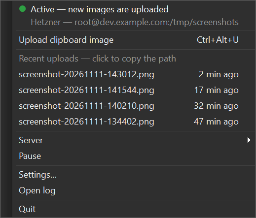
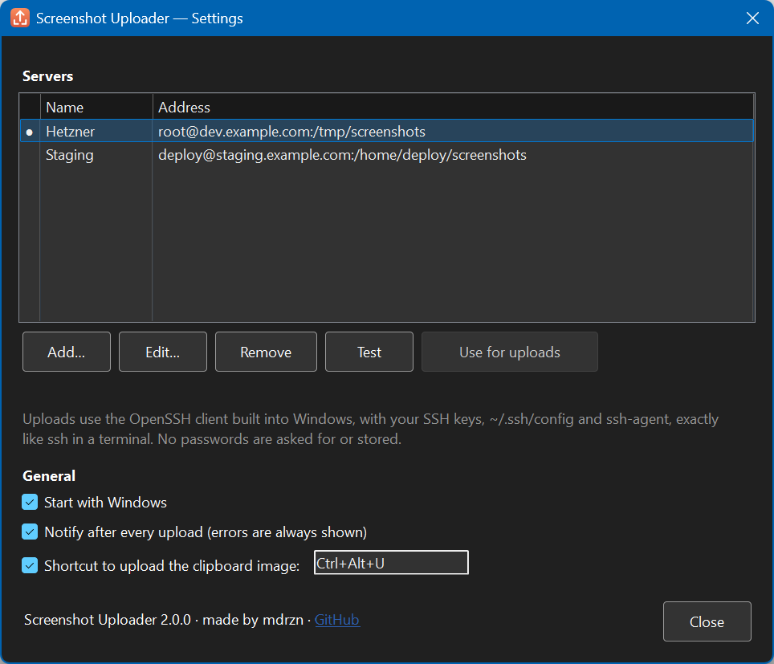

# 📸 Windows Screenshot Uploader

Take a screenshot on Windows, get a path you can paste straight into a remote Claude Code session.


> 🍎 **On a Mac?** The Mac equivalent is at [**mdrzn/claude-screenshot-uploader**](https://github.com/mdrzn/claude-screenshot-uploader).

<table>
<tr>
<td valign="top"></td>
<td valign="top"></td>
</tr>
</table>

## 🤔 Why

When Claude Code runs on a remote server over SSH, it can read files on *that* server — not the image sitting in your Windows clipboard. Pasting a screenshot into the terminal does nothing useful, so you end up repeating the same steps by hand: save the image, `scp` it up, work out where it landed, type the path.

Screenshot Uploader collapses that into one step. Take a screenshot (<kbd>Win</kbd>+<kbd>Shift</kbd>+<kbd>S</kbd>, <kbd>PrtScn</kbd>, ShareX, Greenshot…): the image is uploaded and its remote path **replaces it in the clipboard**, so the only thing left to do is paste.

```
You: have a look at this — /tmp/screenshots/screenshot-20261111-143012.png
Claude: [reads the image]
```

## ✨ Features

- ⚡ **Instant** — Windows tells the app the moment the clipboard changes (no polling, ~0% CPU when idle), and every new image counts: two full-screen screenshots in a row are both uploaded.
- 🖥️ **Multiple servers** — add, edit and **test** SSH connections in Settings, switch from the tray menu.
- 🔒 **Your SSH setup, as is** — uploads go through the OpenSSH client built into Windows, so every key type (ed25519, RSA, ECDSA…), `~/.ssh/config` and `ssh-agent` just work. No passwords asked for or stored. The remote folder is created if it's missing.
- 🕘 **Recent uploads** — the last uploads in the menu; click one to copy its path again.
- ⌨️ **Shortcut** — <kbd>Ctrl</kbd>+<kbd>Alt</kbd>+<kbd>U</kbd> uploads the image in the clipboard by hand (works while paused too); choose another one or turn it off in Settings.
- ⏸️ **Pause / Resume** — from the menu, when you're copying images you don't want uploaded.
- 🔔 **Native notifications** — for every upload, including failures, so nothing fails silently.
- 📦 **One file** — a single `.exe` with .NET included: no Python, no installer, no console window. English and Italian (follows the Windows language).

The tray icon tells you what's going on:


## 🚀 Install

1. Download `ScreenshotUploader.exe` from the [latest release](https://github.com/mdrzn/windows-screenshot-uploader/releases/latest).
2. Put it somewhere permanent, for example `%LOCALAPPDATA%\Programs\ScreenshotUploader\`, and run it.
3. Windows SmartScreen may warn that the app is from an unknown publisher (it isn't code-signed): click **More info → Run anyway**.

New tray icons are often hidden under the **^** arrow: drag the icon onto the taskbar, or turn it on in *Settings → Personalization → Taskbar → Other system tray icons*.

**Build it yourself** — needs the [.NET 10 SDK](https://dotnet.microsoft.com/download):

```powershell
git clone https://github.com/mdrzn/windows-screenshot-uploader.git
cd windows-screenshot-uploader
powershell -ExecutionPolicy Bypass -File app\build.ps1   # -> dist\ScreenshotUploader.exe
```

## 📸 Usage

1. Open **Settings…** from the tray icon, add a server and click **Test**.
2. Take a screenshot — it's uploaded right away and the remote path replaces the image in the clipboard.
3. Paste the path into Claude Code.

| To… | Do |
|:--|:--|
| Upload the image in the clipboard by hand | <kbd>Ctrl</kbd>+<kbd>Alt</kbd>+<kbd>U</kbd>, or *Upload clipboard image* in the menu |
| Re-copy a path | Click it under *Recent uploads* |
| Switch server | *Server* in the menu |
| Stop uploading for a while | *Pause* in the menu (the icon turns gray) |
| Start with Windows | *Start with Windows* in Settings |
| Script it | `ScreenshotUploader.exe --upload`, `--pause`, `--resume`, `--toggle`, `--server <name>`, `--settings`, `--quit` (sent to the running app) |

Only **new** images are uploaded: whatever is already in the clipboard when the app starts, or what you copy while it's paused, is left alone. Text, files copied in Explorer and the path the app writes itself are ignored. If you copy something else while an upload is running, the clipboard isn't touched: the path is still under *Recent uploads*.

## 🔧 Configuration

Settings are stored in `%APPDATA%\ScreenshotUploader\config.json` (you normally edit them in the app), in the same format as the Mac version:

```json
{
  "active": "main",
  "servers": {
    "main": { "name": "Production", "host": "example.com", "user": "root", "path": "/tmp/screenshots" },
    "dev": { "name": "Dev box", "host": "dev", "user": "", "path": "~/screenshots", "port": 2222 }
  },
  "hotkey": "Ctrl+Alt+U",
  "notifications": true
}
```

- `host` can be an alias from `~/.ssh/config`; then `user`, `port` and the key can all come from there.
- `port` and `identity_file` (path to a private key) are optional.
- `hotkey`: `""` turns the shortcut off. `notifications: false` keeps only the error notifications.

The log is in `%APPDATA%\ScreenshotUploader\uploader.log` (*Open log* in the menu).

### 🔑 SSH keys

Uploads never prompt for a password, so key authentication has to work first. In PowerShell:

```powershell
ssh-keygen -t ed25519                     # if you don't already have a key
type $env:USERPROFILE\.ssh\id_ed25519.pub | ssh you@example.com "mkdir -p ~/.ssh && cat >> ~/.ssh/authorized_keys"
ssh you@example.com "echo ok"             # should print ok without asking for anything
```

A host's key is trusted on first contact and pinned in `~/.ssh/known_hosts` after that, so if it later changes the upload fails loudly instead of going through quietly. The **Test** button in Settings runs the same check.

Keys protected by a passphrase work through the Windows `ssh-agent` service (*Services → OpenSSH Authentication Agent → Automatic*, then `ssh-add`).

## 🐛 Troubleshooting

- **Upload failed** — click **Test** next to the server: the reason is shown there. Usually the key isn't installed on the server, the user name is wrong or the host is unreachable.
- **"The server's host key doesn't match"** — the server was reinstalled or its address now points somewhere else. If you trust the change: `ssh-keygen -R <host>`, then **Test** again.
- **"The OpenSSH client isn't installed"** — add it in *Settings → System → Optional features → OpenSSH Client* (it's there by default on Windows 10 1809+ and 11).
- **Nothing happens after a screenshot** — check the icon isn't gray (paused), and that your screenshot tool copies to the clipboard (Snipping Tool does; some tools only save a file).
- **The shortcut doesn't work** — another app may own it: Settings shows "already used by another app"; pick a different one.
- **No notifications** — allow them in *Settings → System → Notifications*, and check Focus / Do not disturb.

## 🧰 Upgrading from 1.x (Python)

Version 2 is a native rewrite. On first launch it imports the servers from the old `config.json`; if the old version still starts with Windows, it offers to turn it off (its `ScreenshotUploader.vbs` is moved to `%APPDATA%\ScreenshotUploader\legacy-backup`, not deleted) and to start the new one with Windows instead.

The Python version lives in [`legacy/`](legacy) for reference, and in the [v1.1.0](https://github.com/mdrzn/windows-screenshot-uploader/releases/tag/v1.1.0) tag.

## 📄 License

MIT — made by [mdrzn](https://github.com/mdrzn).
